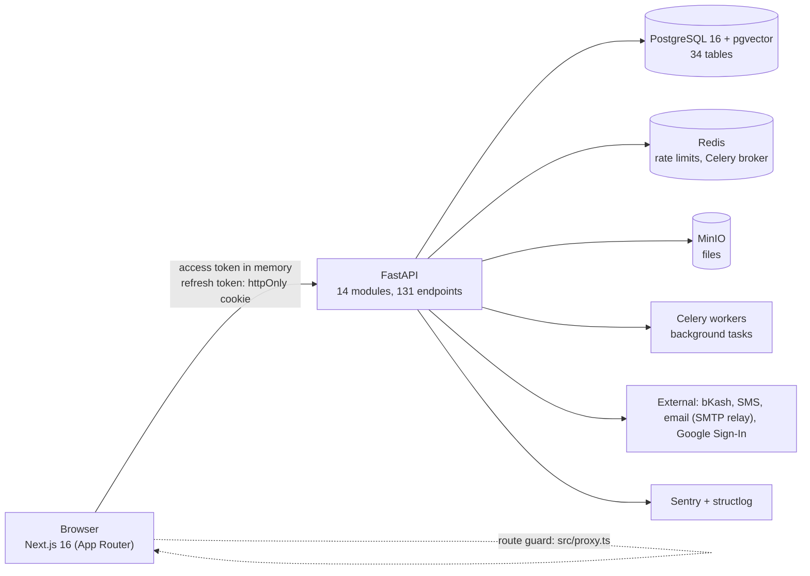
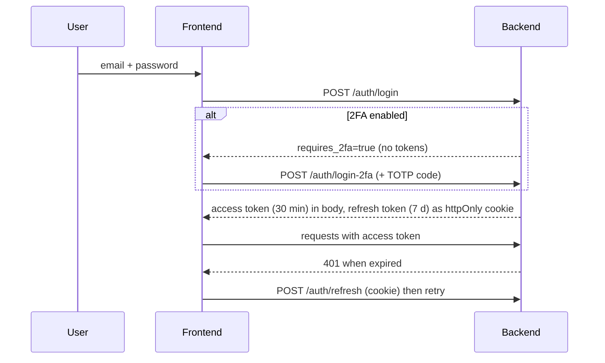
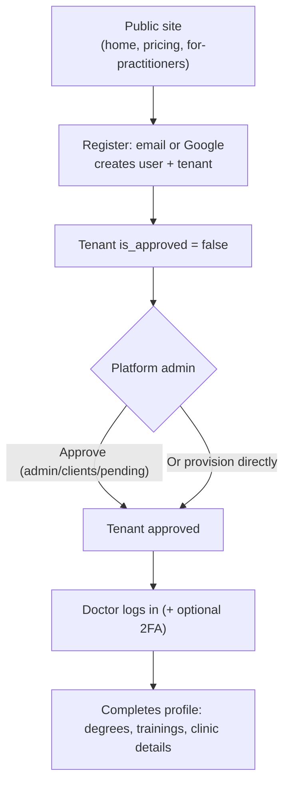
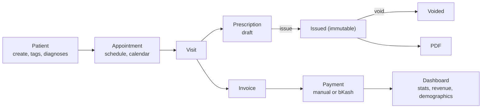
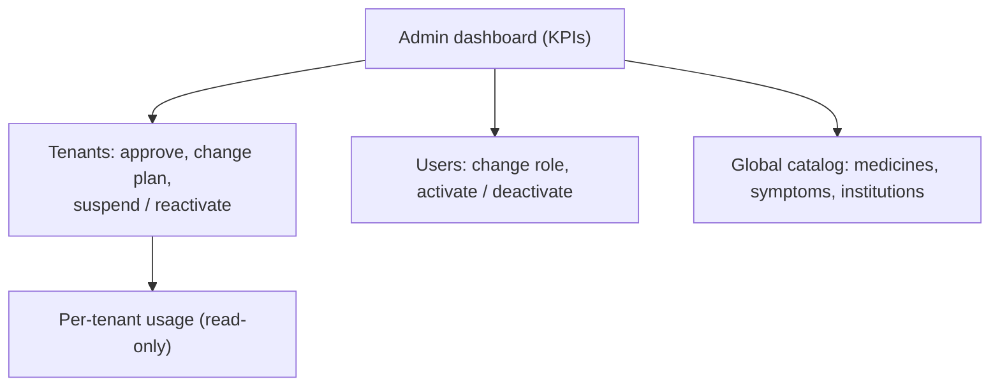

# AltCare — Flows & Architecture Overview

**Date:** 2026-10-10
**Basis:** code and docs as of this date (backend `pytest -q`: 508 passed / 1 xfailed). Where this
document and `docs/planning/revision-2026-09.md` differ on staging or priorities, the revision
document wins; this document is the "how it fits together" view.

AltCare is a **multi-tenant SaaS** for alternative-medicine practitioners (Homeopathy, Ayurveda,
Unani, Herbal). Each doctor or clinic is a **tenant** with isolated data. A **platform admin**
operates the platform above the tenants.

---

## 1. Actors and roles

| Role | Level | `tenant_id` | Does |
|---|---|---|---|
| `admin` | Platform | null | Approves/provisions tenants, manages users and plans, curates the global catalog |
| `operator` | Platform | null | Read-only access to admin endpoints |
| `doctor` | Tenant | uuid | Full clinical workflow for their clinic |
| `receptionist` | Tenant | uuid | Intended: front-desk subset. **Not enforced yet** (pinned as the one `xfail`) |

Platform users are rejected with 403 by every tenant-scoped service factory.

---

## 2. System architecture



- **Frontend:** React 19, Tailwind 4, shadcn/ui, Zustand (client state), React Query (server state),
  next-intl (English/Bengali).
- **Backend:** async SQLAlchemy 2.0, Alembic migrations, Pydantic schemas. Each feature module under
  `backend/app/modules/*` follows routes, then service, then models.
- **Local runtime:** `./run.sh` starts backend (8000) and frontend (3000) against a local
  PostgreSQL and Redis. `docker-compose.yml` is an alternative for local use; nothing deploys it yet.

### 2.1 Backend layering

```
routes.py  (thin: validation, auth dependency, service factory)
   └── service.py  (business rules; BaseTenantService adds tenant_id filter)
         └── shared/models  (SQLAlchemy: TenantScopedModel / GlobalCatalogModel)
```

Global-or-tenant tables (medicines, symptoms, their aliases and mappings) share a
`GlobalCatalogService` read rule: a row is visible if it is global or belongs to the caller's tenant.

---

## 3. Multi-tenant isolation (two layers)

1. **Application layer (active):** `get_current_user()` decodes the JWT; the route's service-factory
   dependency builds `XService(db, tenant_id)`; shared helpers add `.where(model.tenant_id == ...)`.
2. **Database layer (written, currently inert):** `get_current_user()` also sets a per-request
   Postgres setting `app.tenant_id` (transaction-scoped). The 8 clinical tables (`patients`,
   `appointments`, `visits`, `prescriptions`, `prescription_items`, `payments`, `invoices`,
   `patient_diagnoses`) carry a `tenant_isolation` RLS policy on it (migration `273747e56a3f`).

> **Status (2026-10-10):** the app runtime connects as the non-superuser role `altcare`
> (`DATABASE_URL`); Alembic uses the owner role via `MIGRATION_DATABASE_URL`. Grants:
> `backend/scripts/grant_app_role.sql`. Verified: `altcare` without a tenant setting sees 0 patient
> rows while the superuser sees all. Still to do: mirror this in CI and the deploy environment.

---

## 4. Authentication and session flow



- Refresh tokens are stored as SHA-256 hashes and rotate; `token_version` is bumped on password,
  email or role change, which invalidates old tokens.
- Also built: Google Sign-In/registration, password reset, email verification, rate limiting
  (login 5/min per IP), security headers.
- Known local note: login returns 500 if `DATABASE_URL` points at a DB user without table
  privileges (seen 2026-10-10 with the `altcare` role).

---

## 5. Business flows

### 5.1 Tenant onboarding (SaaS entry)



### 5.2 Clinical workflow (doctor)



- Prescriptions are append-only: only drafts are editable. Items reference a `medicine_id` or
  free-text `medicine_name`; the builder autocompletes from the medicine library (aliases included).
- Issuing a prescription, sending an SMS and an AI query each write to `usage_tracking`.

### 5.3 Platform administration



Plan checks (`require_plan`) read the tenant's `plan` / `plan_expires_at` from the database on each
request, so a downgrade takes effect immediately rather than at token expiry.

### 5.4 Public knowledge directory

Unauthenticated pages: `/institutions` (the medicine/symptom catalogs are no longer public — only `GET /public/stats` counts), plus
marketing pages (`/`, `/about`, `/pricing`, `/for-practitioners`).

---

## 6. Feature status

| Area | Status |
|---|---|
| Auth (login, 2FA, Google, reset, verify) | Built |
| Patients, appointments, visits | Built |
| Prescriptions (builder, issue/void, PDF) | Built |
| Payments and invoicing (incl. bKash) | Built |
| Integrations (SMS, email, payment providers) | Built |
| Platform admin (tenants, users, KPIs, usage) | Built |
| Medicine / symptom libraries, institutions directory | Built |
| Bilingual UI (EN/BN) | Built |
| Symptom to medicine lookup UI | Backend only |
| Medicine search page | Uses client-side filter of 100 rows, not `/medicines/search` |
| Receptionist permissions | Not enforced |
| RLS protection | Active locally (app runs as non-superuser); CI/deploy still to mirror |
| Subscription billing and quota blocking | Plan field and usage counters only |
| Book library, AI assistant (RAG) | Models only; AI endpoint returns 501 |
| Specialization-based filtering | Field stored, not used |
| Deployment (IaC, hosted environment) | None |

---

## 7. Recommended order of work

1. ~~DB roles~~ done locally; mirror in CI and the deploy environment.
2. **Receptionist RBAC:** enforce and flip the `xfail` to a passing test.
3. **Symptom to medicine page** and wire the medicine page to `/medicines/search`.
4. **Subscription flow:** plan selection, payment, quota enforcement from `usage_tracking`.
5. **Deploy path:** hosting, secrets, migrations in release, backups.
6. **Library reader, then AI assistant** (pro plan; cites its sources).

Authoritative staging and decisions: `docs/planning/revision-2026-09.md`. Role details:
`docs/architecture/roles-access.md`. Tenancy details: `docs/architecture/multi-tenancy.md`.
