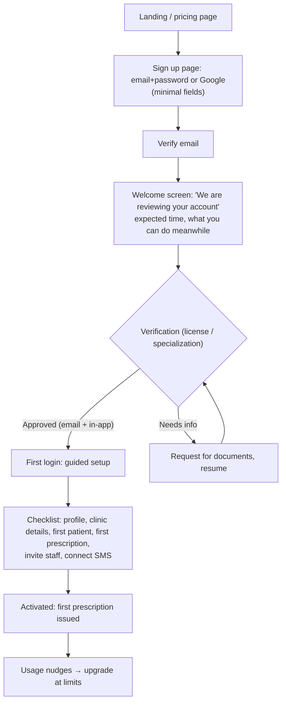

# Pricing, Usage & Onboarding — Product Revision

**Date:** 2026-10-10
**Status:** Proposal for product-owner decision. **Built so far (2026-10-10):** step 1 (signup page, pending state, lifecycle emails) and step 2 (admin-configurable plans and entitlements with enforcement at patient creation, SMS, AI, invoicing and seats; public pricing page rendered from the configuration; admin page `/admin/plans`; per-tenant overrides). Default limits are unlimited, so nothing is capped until an admin sets a value. Findings are verified against the code; everything
under "Recommendation" is a proposal. **No price points are proposed here** — they need evidence
(see §2.4). This supersedes the "Contact us for pricing" stopgap in
`docs/planning/future-scope-2026-09.md` only once the decisions in §5 are made.

---

## 1. What exists today (verified)

| Area | Reality | Where |
|---|---|---|
| Plans | `tenants.plan` is `free` / `plus` / `pro`, plus `plan_started_at`, `plan_expires_at`. Changed only by a platform admin. | `app/shared/models/tenant.py`, admin `PATCH /tenants/{id}` |
| Plan gating | Exactly one thing is gated: the AI endpoint (a 501 stub) requires `pro`. **Nothing distinguishes Free from Plus.** | `require_plan()` in `app/core/dependencies.py` |
| Pricing page | Lists Free / Plus / Pro with feature bullets, no prices, and "Get Started" goes to `/login`. It promises Plus = "payments & invoicing, SMS/email integrations" — **not enforced anywhere**. | `frontend/src/app/(public)/pricing/page.tsx` |
| Billing | None. No payment for the subscription itself, no invoices to tenants, no trial, no renewal, no expiry handling beyond `plan_expires_at` blocking gated features. | — |
| Usage | Daily per-tenant counters: prescriptions created, SMS sent, AI queries, PDFs generated. Read-only, admin-only view (`GET /admin/tenants/{id}/usage`). **No limit is enforced and tenants cannot see their own usage.** | `app/core/usage_tracking.py` |
| Signup | Backend `POST /auth/register` exists (email + password + clinic + 1–4 specializations + Bangladesh location). The frontend only has a **Google** registration step; there is no email/password signup page. | `frontend/src/app/(auth)/register/google` |
| Approval | Every new tenant starts `is_approved=false`. Login returns 403 "Your account is pending admin approval". An admin approves from Clients → Pending. **No email is sent on signup-received or on approval**; only the email-verification mail is sent. | `auth/service.py`, `admin/service.py` |
| After first login | No checklist, no sample data, no guided first patient/prescription. | — |

### Consequences
- A visitor cannot sign up with email/password through the UI, and the pricing page's CTA drops
  them on a login form.
- A new doctor who signs up gets a dead end ("pending approval") with no timeline and no message
  when approved, so they likely never come back.
- Plans are a label, not a product: nothing stops a Free tenant using Plus features.
- The business cannot collect money, cap cost-bearing usage (SMS, AI), or see which tenants are
  healthy.

---

## 2. Pricing

### 2.1 Principles
1. **Price on value and cost drivers, not on features a clinic needs to function.** A doctor who
   cannot save a patient or issue a prescription will leave before upgrading.
2. **Gate what costs you money or what scales with clinic size**: SMS, AI queries, number of
   practitioners/seats, storage. These are already measurable.
3. **Keep the core clinical loop free** so adoption and the shared medicine/symptom catalog grow.
4. **Few tiers, obvious jumps.** Three is fine; each must answer "why would I pay for this?".
5. **Local payments first**: the market is Bangladesh; bKash (already integrated) and BDT billing
   are table stakes. Monthly and annual terms.

### 2.2 Proposed tier structure (structure only)

| | Free | Plus | Pro |
|---|---|---|---|
| Who | Solo practitioner trying the product | Working clinic | Established or multi-doctor practice |
| Core clinical loop (patients, appointments, visits, prescriptions, PDF) | Yes, with a **patient cap** | Higher/no cap | No cap |
| Medicine & symptom library | Yes | Yes | Yes |
| Payments & invoicing | View only or small cap | Yes | Yes |
| SMS / email reminders | None or very small monthly allowance | Monthly allowance (+ top-ups) | Larger allowance |
| Practitioner seats | 1 | 1–3 | More |
| AI knowledge assistant (when built) | — | — | Monthly query quota (CLAUDE.md already plans 200/month) |
| Support | Community / docs | Email | Priority |

**Why these gates:** patient count and seats track clinic size (value); SMS and AI track your
variable cost; payments/invoicing is a clear "I'm running a business" upgrade moment.

### 2.3 Required product mechanics (none exist yet)
- **Entitlements in one place:** a table mapping `plan` to limits and feature flags
  (`max_patients`, `monthly_sms`, `monthly_ai_queries`, `seats`, `invoicing`). Services read it;
  the pricing page renders from it so the page can never promise what the code doesn't enforce.
- **Enforcement points:** create patient, send SMS, AI query, add seat, create invoice. On hitting
  a limit return a structured error the UI turns into an upgrade prompt, not a bare 403.
- **Soft limits first:** warn at 80%, block at 100%, never delete data on downgrade (read-only
  over-cap instead).
- **Subscription lifecycle:** trial, active, past_due, grace period, expired, cancelled; invoices
  to tenants; payment via bKash and/or manual bank transfer confirmed by admin as the first
  version. Expiry already blocks gated features; extend it to a defined grace period and
  downgrade-to-Free behaviour.
- **Self-serve plan page** in Settings: current plan, usage vs limits, upgrade, invoices.

### 2.4 Deciding price points (not guessed here)
- 8–12 interviews with practitioners and clinic owners in two or three cities: what they pay today
  (paper, Excel, other software), SMS spend, who pays (doctor or clinic).
- Van Westendorp-style questions (too cheap / bargain / getting expensive / too expensive) per tier.
- Compute your **cost per active tenant** (SMS, AI tokens, storage, support time) so Plus and Pro
  have a floor.
- Launch with a **founding-member** price for the first N clinics in exchange for feedback, rather
  than a permanent price list.

---

## 3. Usage

### 3.1 Today
Counters exist but are invisible to the people who care. Fix the loop: **measure, show, limit,
act**.

### 3.2 Recommendations
1. **Tenant-facing usage view** in Settings (and a small dashboard widget): this month's
   prescriptions, SMS, AI queries vs plan limits, with the reset date.
2. **Limits tied to §2.3 entitlements**, enforced server-side, using the existing
   `usage_tracking` writers. Count against the calendar month; the month-to-date query already
   exists.
3. **Add the missing meters** needed for the tiers: active patients, seats, storage if uploads
   grow. Keep daily granularity so disputes can be audited.
4. **Admin health view:** per-tenant last-login, weekly actives, usage trend, plan, so you can see
   who is stuck, who is about to hit a limit (upsell), and who has gone quiet (churn risk).
5. **Product analytics for the funnel** (see §4.3), not just usage counters.
6. **Alerts:** email the doctor at 80% and 100% of a limit; notify the admin when a Pro tenant
   goes quiet for 14 days.

---

## 4. Onboarding

### 4.1 Target flow

### 4.2 Specific changes
1. **Add an email/password signup page** (backend already supports it) and point the pricing
   page's "Get Started" at it, passing the chosen plan so the choice is recorded.
2. **Shorten the form:** collect identity and specialization at signup; defer clinic address,
   geography and degrees to the post-login checklist.
3. **Make "pending approval" a designed state, not an error:** after signup and on login, show a
   status page ("received", "in review", expected turnaround, contact route) rather than a 403
   toast.
4. **Email on every step:** signup received, approved, needs more information. Add an admin
   notification (email or dashboard badge) when a new tenant is waiting. Today none of these
   exist.
5. **Decide whether manual approval stays.** It protects catalog and trust (alternative-medicine
   practitioners, licensing), but it is the largest drop-off risk. Options: (a) keep manual
   approval but give a self-serve **sandbox** with sample data until approved; (b) auto-approve
   with license number captured and verify afterwards; (c) auto-approve Free tier, require
   verification only for Plus/Pro or for public directory listing. **Recommendation: (c).**
6. **First-run checklist** on the dashboard with progress: complete profile, add first patient,
   create first prescription, set up a SMS/email provider, invite a receptionist. Optional sample
   patient so the doctor sees a populated product immediately.
7. **Define "activated":** a doctor who has issued their first prescription within 7 days of
   approval. It is the number to optimize.
8. **Role onboarding:** receptionist invitation flow (invite link, role-scoped first screen) once
   receptionist permissions are enforced.
9. **Bilingual from the first screen**, with the language choice remembered (Bengali-first doctors
   are a core audience).

### 4.3 Funnel to instrument
Visit pricing, start signup, submit signup, verify email, approved, first login, profile complete,
first patient, first prescription issued (activation), day-7 return, day-30 return, upgrade.
Review weekly: where is the largest drop?

---

## 5. Decisions needed from the product owner

1. Tier names and the **gating dimensions** in §2.2 (patient cap? seats? SMS? payments?).
2. Who pays: the individual doctor or the clinic (affects seats and invoicing).
3. Manual approval policy (option a, b or c in §4.2).
4. Payment method for subscriptions in v1 (bKash, bank transfer confirmed by admin, card).
5. Whether to run founding-member pricing and for how many tenants.
6. Free-tier limits generous enough to adopt, tight enough to convert.

## 6. Suggested build order

1. Email/password signup page + pricing CTA fix + designed "pending" state + lifecycle emails
   (cheap, removes the biggest leak).
2. Entitlements table and enforcement (patient cap, SMS, seats), with upgrade prompts.
3. Tenant-facing usage view and admin tenant-health view.
4. First-run checklist and activation tracking.
5. Subscription lifecycle and payment collection.
6. Pricing page rendered from entitlements, with real prices once §2.4 is done.

---

## 7. Update (2026-10-12): four plans and seed prices

The plan set is now Free, Plus, Pro and Enterprise, with seed prices and limits chosen from a Bangladesh
market analysis. See `billing-credits-spec-2026-10.md` §9 for the table, the sources, the unit economics and the
list of assumptions that still need validating (§2.4 above is still the right next step).
